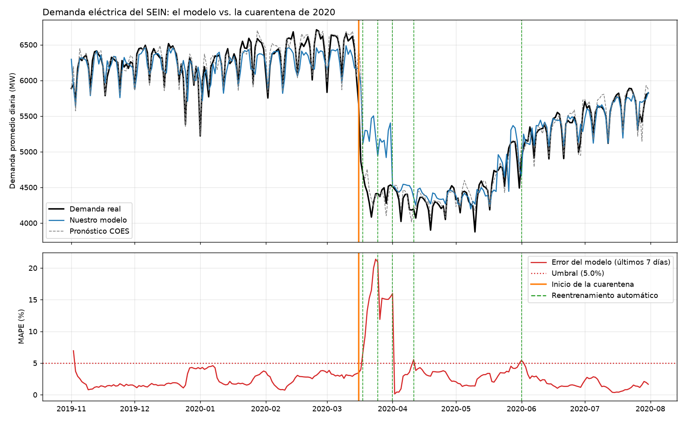
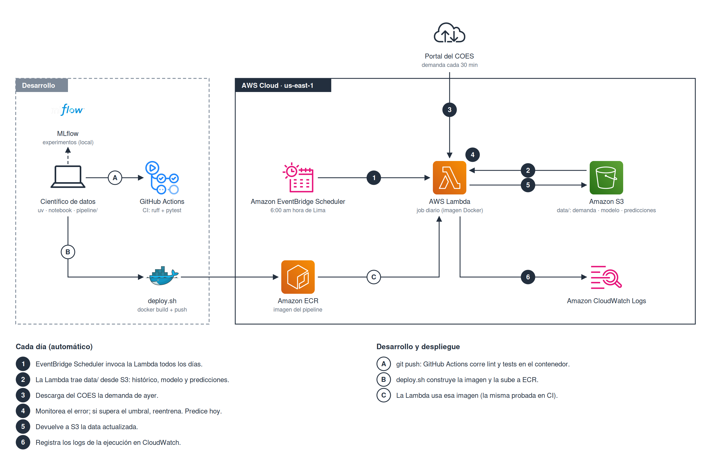

# MLOps en la práctica: pronóstico de la demanda eléctrica del Perú

Proyecto del webinar: cómo pasar de un notebook a un modelo que vive en producción.
Usamos datos reales del [COES](https://www.coes.org.pe/Portal/portalinformacion/demanda):
la demanda eléctrica del SEIN, medida cada 30 minutos.



**La historia:** un modelo simple predice la demanda con ~2-3% de error. El 16 de marzo de 2020
empieza la cuarentena, la demanda cae ~38% en una semana y el modelo se equivoca hasta 20%.
El monitoreo lo detecta y el sistema se reentrena solo. En junio, con la reactivación económica,
la demanda vuelve a subir rápido: otra alerta, otro reentrenamiento.

## El proyecto, paso a paso

Cada etapa es un tag de git. Para ver una etapa: `git checkout <tag>`.
Para ver qué cambió entre dos etapas: `git diff v0-notebook v1-modular`.

| Tag | Qué agrega |
|---|---|
| `v0-notebook` | El modelo en un notebook: exploración, features, entrenamiento, evaluación |
| `v1-modular` | Código separado en scripts + registro de experimentos con MLflow |
| `v2-tests-ci` | Tests automáticos que corren en un contenedor en cada push (GitHub Actions) |
| `v3-nuevos-datos` | Job diario en AWS: trae los datos nuevos y predice solo |
| `v4-monitoreo` | Monitoreo del error y reentrenamiento automático cuando el modelo falla |

## Cómo correrlo

Requisitos: Python 3.12 y [uv](https://docs.astral.sh/uv/).

```bash
uv sync

# El notebook original
uv run jupyter lab notebooks/01_modelo_demanda.ipynb

# El pipeline, paso a paso
uv run python -m pipeline.ingest       # 1. descargar datos del COES (la 1ra vez, todo desde 2016)
uv run python -m pipeline.train        # 2. entrenar (y registrar en MLflow)
uv run python -m pipeline.predict      # 3. predecir la demanda de hoy

# O todo junto, como corre cada día en la nube
uv run python -m pipeline.job_diario

# La demo: simular nov-2019 a jul-2020 día por día (~30 s) -> simulacion_2020.png
uv run python -m pipeline.simular
uv run mlflow ui --backend-store-uri sqlite:///mlflow_simulacion.db   # los reentrenamientos en MLflow

# Ver los experimentos (parámetros y métricas de cada entrenamiento) en http://localhost:5000
uv run mlflow ui --backend-store-uri sqlite:///mlflow.db
```

## El código

| Archivo | Qué hace |
|---|---|
| `pipeline/config.py` | Toda la configuración en un solo lugar |
| `pipeline/ingest.py` | Descarga la demanda cada 30 min del COES y la convierte en un valor por día |
| `pipeline/features.py` | Construye las features. **La misma función** se usa al entrenar y al predecir |
| `pipeline/train.py` | Entrena XGBoost con validación temporal y guarda el modelo |
| `pipeline/registro.py` | Registra parámetros y métricas de cada entrenamiento en MLflow, para comparar experimentos |
| `pipeline/predict.py` | Predice la demanda de un día y guarda la predicción |
| `pipeline/monitor.py` | Compara predicciones con la realidad: error de los últimos 7 días y alerta |
| `pipeline/job_diario.py` | El job de cada día: ingesta, monitoreo, reentrenamiento si hay alerta, predicción |
| `pipeline/aws.py` | Punto de entrada de la Lambda: trae `data/` de S3, corre el job y la devuelve |
| `pipeline/simular.py` | "Viaja en el tiempo": corre el job día por día durante 2020 y grafica |

## Tests y CI

```bash
make test          # lo mismo que corre GitHub Actions en cada push: lint + tests DENTRO del contenedor
make test-rapido   # lint + tests en tu máquina, sin Docker (para iterar rápido)
```

El `Makefile` es la única fuente de verdad: CI solo llama a `make test`, así que si pasa en tu
máquina, pasa en CI.

El `Dockerfile` tiene dos etapas: `produccion` (solo lo necesario para correr el pipeline) y
`tests` (la misma imagen + pytest + los tests). Así probamos exactamente lo que se despliega.

Los tests (`tests/`) usan datos sintéticos, no necesitan internet y verifican lo que más duele
si se rompe: que el dato de las 00:00 vaya al día correcto, que las features nunca usen el día que
se quiere predecir, y que entrenar y predecir funcionen de punta a punta.

## En la nube (AWS)



Todos los días a las 6:00 am (hora de Lima), EventBridge Scheduler invoca la Lambda. La Lambda trae
la carpeta `data/` desde S3, descarga los datos de ayer del COES, monitorea, reentrena si hay alerta,
predice y devuelve `data/` a S3. El diagrama se genera con código (`docs/arquitectura.py`): íconos oficiales de AWS, posiciones a mano.

```bash
aws login                 # o aws configure
./infra/deploy.sh         # crea el bucket, la imagen, la Lambda, los roles y la programación diaria
aws lambda invoke --function-name demanda-sein --cli-read-timeout 310 respuesta.json && cat respuesta.json
./infra/destroy.sh        # borra todo al terminar
```

La Lambda corre la **misma imagen** que se probó en CI (etapa `produccion` del `Dockerfile`).
Costo: prácticamente cero (una ejecución de ~1 minuto al día y unos pocos MB en S3).

**¿Por qué la hora de Lima en el código?** Los servidores en la nube corren en UTC: después de
las 7 pm en Perú, para el servidor ya es "mañana". Este bug apareció de verdad al probar la
Lambda; ahora tiene su test (`tests/test_job_diario.py`).

**El modelo:** la demanda promedio de un día se predice con la de los 14 días anteriores
(`lag_1` ... `lag_14`) y el día de la semana. XGBoost no sabe nada de tiempo: convertimos la
serie en una tabla con `shift()`. Benchmark: el pronóstico oficial del COES.

## Preguntas frecuentes

**¿Por qué monitorear el error y no el drift de los datos?** En series de tiempo la distribución
de los datos cambia siempre (verano vs. invierno): un detector de drift sobre los inputs alertaría
todo el tiempo. Como aquí el valor real llega al día siguiente, medimos directamente lo que importa:
el error. En problemas donde la respuesta tarda meses (por ejemplo, la mora de un crédito), no hay
esa suerte y se vigila el drift de los datos como señal temprana.

**¿Por qué esperar 7 días antes de dar una alerta?** Para no reaccionar a un solo día raro
(un feriado dispara el error de ese día) y darle a cada modelo nuevo una oportunidad justa.

**¿Por qué reentrenar cuando hay alerta y no cada semana?** Reentrenar "a ciegas" cuesta y
puede empeorar un modelo que funcionaba bien. Reentrenar por alerta responde a lo que pasa en el
mundo. En la versión `v3-nuevos-datos` el job reentrenaba cada 7 días: compáralo con `git diff
v3-nuevos-datos v4-monitoreo -- pipeline/job_diario.py`.

**¿Por qué XGBoost falla tanto con la cuarentena?** Los árboles no extrapolan: nunca vieron una
demanda de 4,000 MW y no pueden predecirla. Hasta que se reentrenan con datos nuevos.

## Datos

Los datos no se incluyen en el repositorio: el código los descarga directamente del COES.
Revisa los [términos y condiciones del COES](https://www.coes.org.pe/Portal/Organizacion/TerminosyCondiciones)
antes de cualquier uso comercial o redistribución.
